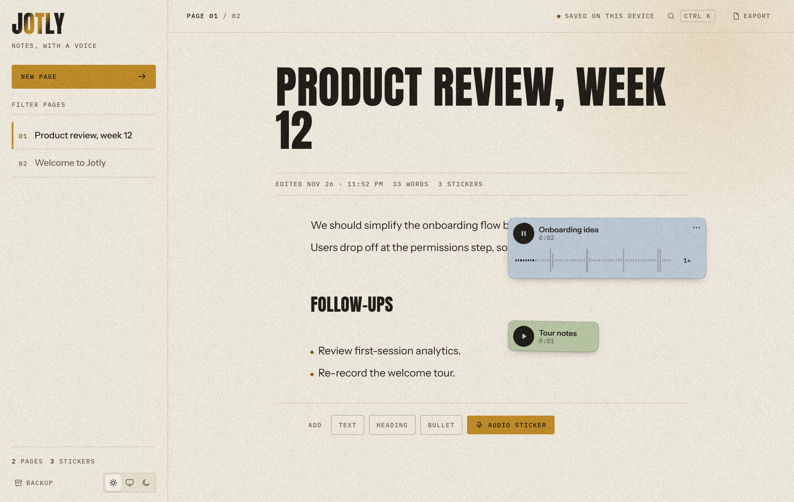
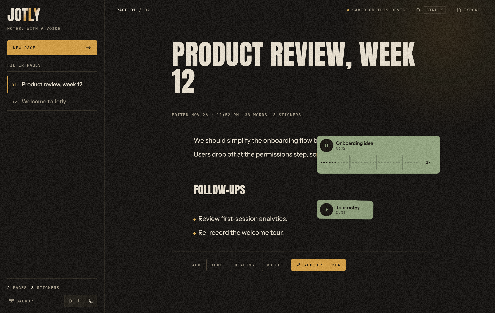
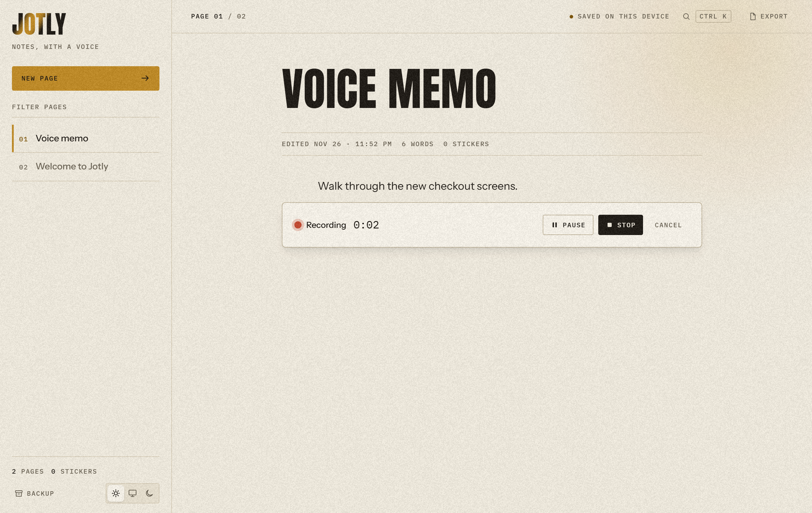
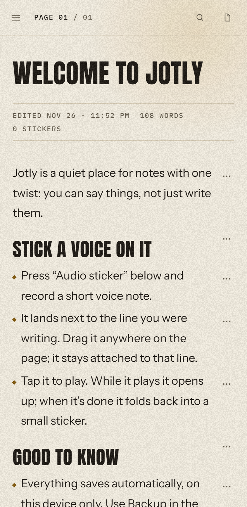

<div align="center">

# JOTLY

**Notes, with a voice.**

Write it. Say it. A minimal notes app where short voice recordings live on the page as small, movable *audio stickers*.


<br />



</div>

<br />

## Why Jotly

Some thoughts are quicker to say than to type. Jotly lets you drop a short voice clip right next to the line it explains, then fold it away into a tiny sticker until you want to hear it again. No account, no server, nothing leaves your device.

## Features

| | |
|---|---|
| **Audio stickers** | Record with pause and resume, preview, and the sticker lands beside the line you were writing. |
| **Move them anywhere** | Drag a sticker to any spot on the page, or nudge it with the arrow keys. It stays attached to its line and travels with that text. |
| **Small until you play** | Idle stickers are compact. Press play and one opens with a waveform, scrubbing and 1x / 1.5x / 2x speed, then folds back when it ends. |
| **Fast writing** | Paragraph, heading and bullet lines. Type `# ` or `- ` for shortcuts. Reorder with drag or `Alt` + `↑` / `↓`. |
| **Honest autosave** | "Saved on this device", with retries and a flush when you close the tab. |
| **Find and keep** | Search every page and sticker title with `Ctrl/⌘ K`. Export Markdown, or back up and restore everything (pages and audio) as a `.zip`. |
| **Looks after you** | Light, dark and system themes, reduced-motion support, full keyboard access. |

## A look around

<table>
  <tr>
    <td width="50%"></td>
    <td width="50%"></td>
  </tr>
  <tr>
    <td align="center"><sub><b>Dark theme.</b> Warm ink, one muted ochre accent.</sub></td>
    <td align="center"><sub><b>Recorder.</b> Pause, resume, stop, up to 5 minutes.</sub></td>
  </tr>
</table>

<div align="center">
  
  <br />
  <sub><b>On a phone.</b> The same page, one column.</sub>
</div>

## Design

An editorial look rather than a generic app skin: **Anton** for display, **Instrument Sans** for text and **IBM Plex Mono** for labels, on warm paper and ink with a single muted ochre accent and a touch of film grain. Motion comes from [Motion](https://motion.dev), smooth scrolling from Lenis, and a handful of [React Bits](https://reactbits.dev) components (ShinyText, BlurText, SpotlightCard, CountUp, Magnet, Noise).

## Run it

You need Node.js 22 or newer.

```bash
git clone https://github.com/shailkamtikar/Jot-ly.git
cd Jot-ly
npm ci
npm run dev
```

Then open **http://localhost:5273**. Full step-by-step help, including troubleshooting, is in [HOW_TO_RUN.md](HOW_TO_RUN.md).

| Command | What it does |
|---|---|
| `npm run dev` | Start the app on port 5273 |
| `npm run check` | Lint, typecheck, unit tests and production build |
| `npm run e2e` | Playwright browser tests (first run: `npx playwright install chromium`) |
| `npm run build` | Production build into `dist/` |
| `node scripts/screenshots.mjs` | Regenerate the screenshots above (app must be running) |

## Local-first, honestly

There is **no server and no account**. Everything lives in your browser's IndexedDB on this device, so clearing site data deletes your notes. Use **Backup** in the sidebar to keep a copy. Microphone access needs HTTPS or `localhost`. Cloud sync is a possible later stage, see [the knowledge base](docs/KNOWLEDGE_BASE.md).

## Under the hood

- **Stack:** Vite, React 19, TypeScript (strict), Tailwind CSS v4, Motion, Lenis, `idb`, `fflate`, Vitest, Playwright.
- **Stickers are anchored to lines.** Each sticker stores a horizontal fraction and an offset from its line, so reflowing or reordering text never strands it.
- **Safe storage.** Pages and audio are saved together atomically through a serial, latest-wins queue; a schema version with migrations protects older notes.
- **A small custom editor** (one auto-sizing `<textarea>` per line) keeps IME, spellcheck and mobile keyboards native. The document is plain JSON, so moving to Tiptap later stays possible.
- **Light bundle:** about 178 KB gzipped JavaScript, see [docs/PERF.md](docs/PERF.md).

## Project docs

- [HOW_TO_RUN.md](HOW_TO_RUN.md): start the app locally
- [docs/KNOWLEDGE_BASE.md](docs/KNOWLEDGE_BASE.md): product and architecture reference
- [docs/PLAYBOOK.md](docs/PLAYBOOK.md): milestone-by-milestone build and test plan
- [docs/PERF.md](docs/PERF.md): bundle size notes
