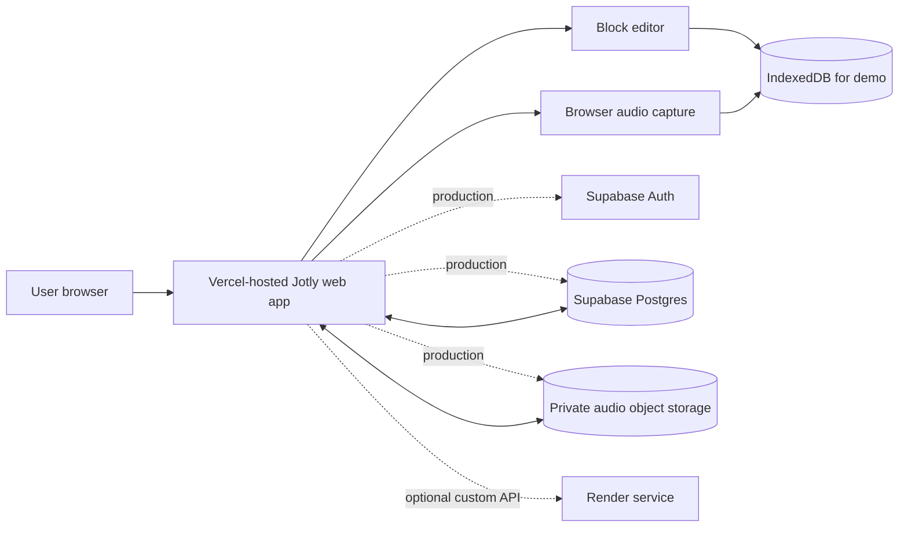
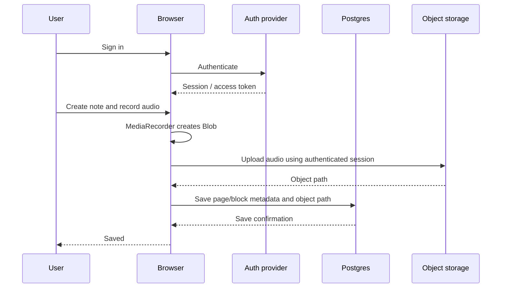
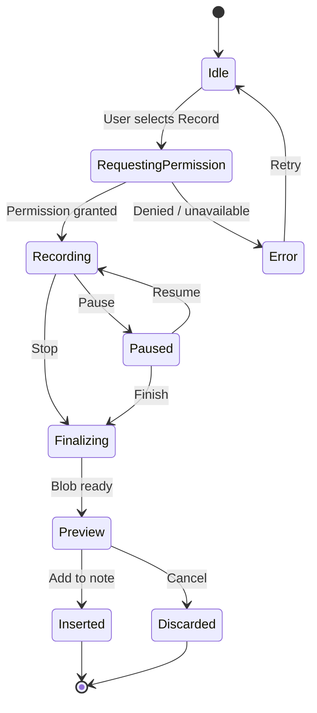

# Jotly — Product & Technical Knowledge Base

**Document type:** Product specification, architecture reference, and implementation knowledge book  
**Project:** Jotly  
**Status:** Browser-only demo prototype; production architecture proposed  
**Last reviewed:** 2026-11-26  
**Primary purpose:** A web-based note-taking application that lets people combine written notes with short, inline audio recordings (“audio stickers”).

---

## Document conventions

This document distinguishes what exists from what is proposed:

- **Confirmed** — explicitly established by the project brief or verified in the current demo files.
- **Proposed** — a recommended product or engineering direction, not yet implemented or approved.
- **Assumption** — a reasonable working assumption that needs confirmation.
- **TBD** — a decision that remains open.
- **Research note** — a technical statement supported by the linked official documentation.

The project brief describes a Notion-inspired, web-only notes application, with Vercel as the preferred frontend host and Render as an optional backend host. Its defining interaction is inserting short audio recordings between written note blocks so users can explain or contextualize their notes with their own voice.

## Table of contents

1. [Executive summary](#1-executive-summary)
2. [Product identity and principles](#2-product-identity-and-principles)
3. [Target users and jobs to be done](#3-target-users-and-jobs-to-be-done)
4. [Product scope and feature specification](#4-product-scope-and-feature-specification)
5. [Current demo: verified implementation](#5-current-demo-verified-implementation)
6. [User experience and interaction design](#6-user-experience-and-interaction-design)
7. [Recommended production architecture](#7-recommended-production-architecture)
8. [Technology stack](#8-technology-stack)
9. [Data model and persistence](#9-data-model-and-persistence)
10. [Audio recording and playback engineering](#10-audio-recording-and-playback-engineering)
11. [Editor architecture and document model](#11-editor-architecture-and-document-model)
12. [API and service boundaries](#12-api-and-service-boundaries)
13. [Security, privacy, and reliability](#13-security-privacy-and-reliability)
14. [Performance and accessibility](#14-performance-and-accessibility)
15. [Testing and quality assurance](#15-testing-and-quality-assurance)
16. [Deployment and operations](#16-deployment-and-operations)
17. [Risks, constraints, and trade-offs](#17-risks-constraints-and-trade-offs)
18. [Roadmap and extensibility](#18-roadmap-and-extensibility)
19. [Open decisions](#19-open-decisions)
20. [Glossary](#20-glossary)
21. [References](#21-references)

---

## 1. Executive summary

Jotly is a web-based notes workspace inspired by the clarity and block-based editing model of Notion. Its key differentiator is **audio stickers**: small, self-contained voice recordings that live inline among ordinary note blocks.

A note is not merely a text field with an audio attachment. It is an ordered document made of blocks. A user can write a paragraph, insert an audio sticker, continue writing, and insert further recordings wherever additional explanation is useful.

### 1.1 Product objective

Provide a fast, calm, polished place to capture thoughts in both written and spoken form, without forcing the user to switch to a separate voice recorder or attach audio at the end of a document.

### 1.2 Confirmed product constraints

| Area | Confirmed direction |
|---|---|
| Product name | Jotly |
| Product category | Notes application |
| Delivery | Web-based only; no native mobile app required for the initial scope |
| UX reference | Notion-like information architecture and editing experience |
| Signature feature | Audio stickers inserted between note blocks |
| Frontend hosting preference | Vercel |
| Backend hosting preference | Render, only if a separate backend is needed |
| Initial release type | A functioning demo/prototype is acceptable |
| Motion | Smooth, polished transitions are a core quality goal |

### 1.3 Recommended product strategy

**Proposed:** Build the first release as a browser-first, single-user demo with durable local browser storage. Do not introduce a separate Render backend until cross-device sync, accounts, sharing, or server-side processing is required.

For a multi-user product, add authentication, a database, and private object storage. Keep the frontend on Vercel. A separate Render service is optional: it is justified only if Jotly needs custom server workloads, complex integrations, long-running jobs, or backend logic that is not well handled by the chosen managed data platform.

---

## 2. Product identity and principles

### 2.1 Name

**Jotly** is the chosen product name.

Working positioning line:

> Think it. Write it. Say it.

This is a proposed tagline, not a registered or trademark-cleared slogan.

### 2.2 Core product principles

1. **Writing and voice belong in the same document.** Audio must be a first-class block, not an unrelated attachment list.
2. **Low-friction capture.** A user should be able to add a note or record a thought without navigating through several screens.
3. **The document remains readable.** Audio cards should be compact and visually distinct without overpowering written content.
4. **Autosave is expected.** Users should not need to remember to press Save.
5. **Motion supports comprehension.** Animations should communicate state changes and spatial relationships, not decorate every action.
6. **Browser-first delivery.** The product must work in modern desktop and mobile browsers.
7. **Honest data behavior.** The UI must clearly distinguish local-only demo data from cloud-synced account data.

### 2.3 Product differentiation

The defining interaction is the ability to interleave voice and text naturally:

```text
Project planning
  Text block: We should simplify the onboarding flow.

  Audio sticker — 00:24
  "The biggest issue is that new users don't understand
   what to do after creating an account."

  Heading: Follow-up
  Bullet: Review first-session analytics.
  Bullet: Test a shorter welcome checklist.
```

The audio sticker captures tone, nuance, context, or an explanation that would be slower or less expressive to type.

---

## 3. Target users and jobs to be done

### 3.1 Initial audience

**Assumption:** The initial audience is individuals who take personal notes, students, creators, knowledge workers, and people who think aloud while organizing information.

The first demo does not need team collaboration or enterprise administration.

### 3.2 Jobs to be done

- Capture a quick thought before it is forgotten.
- Explain a written point with a short voice note.
- Record meeting context beside the relevant action item.
- Keep related text and voice together in one document.
- Revisit, play, rename, move, or remove a recording later.
- Find a note quickly from a page list or search/filter control.

### 3.3 Out of initial scope

Unless later approved, the following are not initial requirements:

- Native iOS or Android applications.
- Real-time multi-user collaboration.
- Public publishing or shared workspaces.
- AI transcription, summaries, or semantic search.
- End-to-end encrypted notes.
- Team administration, billing, and enterprise SSO.
- Full Notion feature parity.

---

## 4. Product scope and feature specification

### 4.1 Workspace and navigation

**Required / current demo baseline**
- A workspace shell with a sidebar.
- A list of pages.
- Create a new page.
- Filter page titles.
- Switch between pages.
- A main editor area with a title and page content.
- A responsive layout suitable for smaller screens.

**Proposed improvements**
- Favorites and recent pages.
- Nested pages and breadcrumbs.
- Keyboard navigation.
- Global search across titles and content.
- Sidebar collapse/expand with smooth motion.
- Empty states and onboarding hints.

### 4.2 Notes and block editor

A page is an ordered list of content blocks. The first production block types should be:

| Block | Purpose | Priority |
|---|---|---|
| Paragraph | Ordinary editable text | P0 |
| Heading 1 / Heading 2 | Structure and hierarchy | P0 |
| Bulleted list item | Concise lists | P0 |
| Audio sticker | Inline voice recording | P0 |
| Numbered list | Ordered steps | P1 |
| Checklist | Action tracking | P1 |
| Divider | Visual section separation | P1 |
| Image | Visual reference | P2 |
| Link/embed | External context | P2 |

P0 means required for the core experience. P1 and P2 are proposed later increments.

**Editor behavior**
- Blocks appear in a stable document order.
- Users can add blocks from an insertion control.
- Enter creates a following text or list block where appropriate.
- Empty blocks can be removed safely.
- Blocks can be reordered.
- Edits update the document model and trigger autosave.
- The editor must preserve the relative position of audio blocks when text blocks are edited or reordered.

**Notion-like features to consider after the core editor is reliable**
- Slash command menu.
- Drag handles and drag-and-drop.
- Inline formatting (bold, italic, underline, links).
- Keyboard shortcuts.
- Nested lists and subpages.
- Undo/redo and version history.

Do not claim these advanced editing behaviors are implemented in the current prototype unless they are actually added and tested.

### 4.3 Audio stickers

Audio stickers are the signature Jotly block.

**Core requirements**
- Request microphone access only after an explicit user action.
- Start, pause, resume, and stop a recording.
- Display elapsed recording time.
- Finalize the recording as an audio blob.
- Insert the audio block at a defined document position.
- Persist the binary audio data with the page in the local demo.
- Play and pause an existing recording.
- Rename the sticker.
- Delete the sticker.
- Display duration and a compact waveform-like visualization.
- Release microphone tracks when recording ends or is cancelled.
- Handle denied permissions and unsupported recording formats gracefully.

**Proposed refinements**
- Real waveform derived from audio samples rather than decorative bars.
- Scrubbing and current playback position.
- Multiple playback speeds (for example 0.75×, 1×, 1.25×, 1.5×, 2×).
- Recording cancellation confirmation if a recording is in progress.
- Optional recording limit with a clear timer and warning.
- Insert at the cursor/current block position, not only at the end of the page.
- Download audio.
- Replace an existing audio sticker while retaining its position and title.

### 4.4 Search, export, and appearance

**Current demo baseline**
- Page title filtering.
- Markdown export of the active note.
- Light and dark appearance modes.

**Proposed**
- Full-text search over page titles and text blocks.
- Search result snippets and keyboard shortcut.
- Export page as Markdown with audio placeholders and optional audio files.
- Export/import a complete backup archive.
- Persist theme preference.
- Respect operating-system reduced-motion preference.

### 4.5 Autosave and offline behavior

For the demo, autosave is local to the browser profile. For a future signed-in product, autosave should sync to a remote database and object storage.

The UI should communicate one of these states:
- `Saving…`
- `Saved`
- `Offline — saved on this device`
- `Sync failed — retrying`
- `Microphone unavailable`

Avoid displaying “Saved” until the local transaction or remote write has actually completed.

---

## 5. Current demo: verified implementation

The current demo is a small, browser-only prototype made from a standalone `index.html` and `README.md`. The README describes it as a Notion-inspired note-taking demo with inline audio stickers.

### 5.1 Verified capabilities in the supplied demo

| Capability | Verified behavior |
|---|---|
| Pages | Multiple editable pages |
| Page filtering | Filters the visible page list by title |
| Editor | Text, heading, and bullet blocks |
| Audio recording | Browser microphone capture |
| Recording controls | Start, pause, resume, stop/finalize flow |
| Inline audio | Adds an audio block to the page |
| Playback | Plays recorded blobs |
| Audio speed | Cycles playback speed between 1×, 1.5×, and 2× |
| Sticker title | Editable name |
| Delete | Audio block can be deleted |
| Autosave | IndexedDB stores page records and audio blobs |
| Theme | Light/dark mode; theme preference uses localStorage |
| Export | Exports active note as Markdown |
| Responsive layout | Responsive styles are present |
| Backend | None |
| Accounts / cloud sync | None |

### 5.2 Known demo limitations

- Data remains in the current browser profile; it does not sync across devices.
- There is no account or authentication system.
- Microphone access requires browser permission and a secure context (HTTPS or localhost).
- The initial sample audio sticker is illustrative and is not a playable recording.
- The waveform bars are decorative approximations, not a measured waveform from the audio signal.
- The demo is a frontend prototype, not a production multi-user service.
- The editor is intentionally lightweight and is not full Notion parity.
- The current audio insertion flow appends the sticker to the page's block list; precise cursor-position insertion is a future improvement.
- Current reordering controls are limited; full drag-and-drop is not present.
- Markdown export represents audio stickers as text placeholders; it does not package the audio binaries.

### 5.3 Running the demo locally

The demo can be served with a simple local HTTP server:

```bash
python3 -m http.server 8000
```

Open `http://localhost:8000`.

Do not rely on opening `index.html` directly using a `file://` URL for microphone functionality. Use localhost or HTTPS.

### 5.4 What the demo proves

The demo demonstrates that the core concept is feasible in a browser: editable text blocks and recorded audio blobs can coexist in one ordered page and persist locally using IndexedDB.

It does **not** prove:
- Multi-device synchronization.
- Account security.
- Cloud backup.
- Production-scale audio storage.
- Cross-browser behavior on every device.
- Collaboration or conflict resolution.

---

## 6. User experience and interaction design

### 6.1 Main layout

**Proposed production layout**

```text
┌──────────────────────────────────────────────────────────────┐
│ Sidebar             │ Top bar: breadcrumb · save · theme     │
│                     ├────────────────────────────────────────┤
│ Jotly               │                                        │
│ New page            │          Page title                    │
│ Search              │          Last edited / privacy state   │
│                     │                                        │
│ Your pages          │          Paragraph block               │
│  • Meeting notes    │          Audio sticker                  │
│  • Ideas            │          Heading                        │
│  • Study notes      │          Bullet list                    │
│                     │                                        │
│ Theme / settings    │          + Text  + Heading  + Audio     │
└─────────────────────┴────────────────────────────────────────┘
```

### 6.2 Motion design

The product brief explicitly calls for almost seamless, smooth motion. Motion should be purposeful and restrained.

Recommended motion:
- Page changes: short opacity/vertical transition.
- Sidebar: smooth width/position transition.
- Audio recording: gentle pulse while recording.
- Audio card hover: subtle elevation or border emphasis.
- Inserted blocks: short fade/translate entrance.
- Menus and dialogs: fade plus small scale transition.
- Save status: text crossfade, not a disruptive toast for every keystroke.

Suggested starting values (design recommendations, not strict standards):
- Micro-interactions: 120–180 ms.
- Menus and cards: 160–220 ms.
- Page transitions: 180–260 ms.
- Easing: ease-out for entrances; ease-in for exits.
- Avoid large layout shifts and long animations that slow editing.

Respect `prefers-reduced-motion: reduce`. Motion must never be required to understand whether recording or saving is active.

### 6.3 Audio sticker visual hierarchy

Each audio card should expose:
1. Play/pause control.
2. Sticker title.
3. Duration.
4. Waveform/progress visualization.
5. Playback speed.
6. More-actions menu (rename, download, delete).

On narrow screens, actions can move into an overflow menu. The play control and title should remain visible.

### 6.4 Accessibility

- Every icon-only control needs an accessible name.
- Keyboard focus must be visible.
- Recording state must be announced to assistive technology.
- Do not communicate state by color alone.
- Audio controls need keyboard operability.
- Dialogs need focus management and Escape behavior.
- Editor blocks need meaningful semantics and labels.
- Ensure contrast in both themes.
- Provide a visible permission explanation before or when microphone access is requested.

---

## 7. Recommended production architecture

### 7.1 Architecture decision

**Recommendation:** Use a staged architecture.

**Stage A — demo / local-first**
- Static or client-heavy web app hosted on Vercel.
- IndexedDB for pages and audio blobs.
- No Render backend.
- No account system.
- This is sufficient for a demo and avoids premature infrastructure.

**Stage B — personal cloud product**
- Next.js frontend hosted on Vercel.
- Supabase Auth for user identity.
- Supabase Postgres for page and block metadata.
- Supabase Storage private bucket for audio blobs.
- Row Level Security (RLS) for user-level data isolation.
- A separate Render API is not required initially.

**Stage C — custom backend only when justified**
- Add a Render web service if custom business logic, long-running processing, integrations, webhook handling, or a non-Next.js API becomes necessary.
- Keep service credentials server-side.
- The backend must validate the authenticated user and authorize every resource operation.

### 7.2 High-level diagram



### 7.3 Production data flow



### 7.4 Why not add Render immediately?

A separate backend adds deployment, monitoring, secrets, network boundaries, API contracts, and maintenance. For a demo with browser-local persistence, none of that is necessary.

A managed database/auth/storage platform can provide the remote capabilities required by a small SaaS product. Render remains a valid option for a custom API later. Do not add infrastructure merely because it appeared in the initial hosting preference.

---

## 8. Technology stack

The following is a recommended stack, not a claim that all of it exists in the current HTML demo.

| Layer | Recommendation | Purpose |
|---|---|---|
| Language | TypeScript | Safer data models and application code |
| Web framework | Next.js App Router | Application routing, layouts, server/client boundaries |
| UI | React | Component model |
| Styling | Tailwind CSS or CSS modules | Consistent design system |
| Motion | Motion for React (formerly Framer Motion) or CSS transitions | Interface transitions |
| Editor | Tiptap | Extensible structured rich-text editing |
| Icons | Lucide | Consistent interface icons |
| Audio capture | MediaDevices + MediaRecorder browser APIs | Microphone capture and recording |
| Audio playback | HTMLAudioElement / Web Audio API | Playback and analysis |
| Waveform | Web Audio API or Wavesurfer.js | Visual waveform and seeking |
| Demo storage | IndexedDB | Structured local data and audio blobs |
| Cloud database | Supabase Postgres | Durable remote metadata |
| Authentication | Supabase Auth | User sessions and identity |
| Audio storage | Supabase Storage private bucket | Durable audio object storage |
| Frontend hosting | Vercel | Deploy web application |
| Optional backend | Render Web Service | Custom API/workers when needed |
| Testing | Vitest + Playwright | Unit and browser end-to-end tests |

### 8.1 Next.js and React

Next.js is a React framework for building web applications. The App Router uses file-system routing and React Server Components, while interactive browser-only functionality belongs in Client Components.

Use Client Components for:
- Tiptap editor instance.
- MediaRecorder and microphone permissions.
- Audio playback.
- IndexedDB access.
- Browser theme and keyboard interactions.

Keep server components for static layout, metadata, and server-side data loading where useful. Do not attempt to access `window`, `navigator`, IndexedDB, or MediaRecorder during server rendering.

Official docs:
- Next.js: https://nextjs.org/docs
- App Router: https://nextjs.org/docs/app
- Deploying: https://nextjs.org/docs/app/getting-started/deploying

### 8.2 Tiptap

Tiptap is a headless, extensible editor framework based on ProseMirror. It is a strong fit if Jotly evolves from the current lightweight custom block editor into a richer editing surface.

Potential implementation:
- Use StarterKit for common text editing.
- Add custom node extensions for audio stickers.
- Store the document as structured JSON.
- Render audio nodes using a React node view.
- Use transactions for changes and preserve editor history.

Important integration note: Tiptap's Next.js guide recommends creating the editor client-side and setting `immediatelyRender: false` to avoid hydration mismatch issues in the documented setup.

Official guide: https://tiptap.dev/docs/editor/getting-started/install/nextjs

### 8.3 Browser recording APIs

Use:
- `navigator.mediaDevices.getUserMedia({ audio: true })` to request microphone access.
- `MediaRecorder` to encode a MediaStream.
- `dataavailable` events to collect Blob chunks.
- `stop` to finalize the recording.
- `MediaRecorder.isTypeSupported()` to select a supported recording MIME type.

Microphone capture is available only in secure contexts, normally HTTPS, with localhost treated as a development exception. Permission can be denied or unavailable.

Official references:
- MediaStream Recording API: https://developer.mozilla.org/en-US/docs/Web/API/MediaStream_Recording_API
- MediaRecorder: https://developer.mozilla.org/en-US/docs/Web/API/MediaRecorder
- getUserMedia: https://developer.mozilla.org/en-US/docs/Web/API/MediaDevices/getUserMedia

### 8.4 IndexedDB

Use IndexedDB for the local demo because it supports structured records and binary Blob data asynchronously. It is a better fit for note documents plus audio blobs than localStorage.

Use localStorage only for small preferences such as theme selection, not for recorded audio.

Official references:
- IndexedDB API: https://developer.mozilla.org/en-US/docs/Web/API/IndexedDB_API
- Using IndexedDB: https://developer.mozilla.org/en-US/docs/Web/API/IndexedDB_API/Using_IndexedDB

### 8.5 Supabase

Supabase is a proposed Stage B choice because it combines Postgres, authentication, generated APIs, and object storage. Its Data API can be used from a browser when tables are protected by RLS and the client uses a publishable key. Never expose service-role or secret keys in browser code.

Use private storage for user recordings. Storage access policies must be configured independently and deliberately.

Official references:
- Auth: https://supabase.com/docs/guides/auth
- Data API: https://supabase.com/docs/guides/api
- Secure data: https://supabase.com/docs/guides/database/secure-data
- Storage quickstart: https://supabase.com/docs/guides/storage/quickstart
- Storage access control: https://supabase.com/docs/guides/storage/security/access-control
- Private/public buckets: https://supabase.com/docs/guides/storage/buckets/fundamentals

### 8.6 Hosting

- **Vercel:** preferred frontend hosting. Git-based deployments and preview environments are useful for iterative product development.
- **Render:** optional custom Node.js API host if Jotly grows beyond the managed platform approach.

Official references:
- Vercel docs: https://vercel.com/docs
- Next.js on Vercel: https://vercel.com/docs/frameworks/full-stack/nextjs
- Render docs: https://render.com/docs

### 8.7 Alternatives

| Need | Primary choice | Alternatives | Trade-off |
|---|---|---|---|
| Rich editor | Tiptap | Lexical, custom editor | Custom editor is lighter but expensive to extend safely |
| Backend data | Supabase | Firebase, custom Postgres API | Supabase gives relational structure and RLS; Firebase offers a different document-first model |
| Local database | IndexedDB | localStorage, OPFS | IndexedDB is structured and Blob-friendly; localStorage is string-only and synchronous |
| Audio waveform | Web Audio API / Wavesurfer.js | Static decorative waveform | Real waveform is more meaningful but requires decoding/processing |
| Backend hosting | None initially | Render, Railway, Fly.io | Add only when custom server behavior is required |

---

## 9. Data model and persistence

### 9.1 Document model

A note is a page with metadata and an ordered array of blocks.

**Proposed JSON shape**

```json
{
  "id": "page_uuid",
  "ownerId": "user_uuid_or_local",
  "title": "Meeting notes",
  "blocks": [
    {
      "id": "block_uuid_1",
      "type": "paragraph",
      "content": "We discussed the launch plan."
    },
    {
      "id": "block_uuid_2",
      "type": "audio",
      "audioId": "audio_uuid",
      "title": "Launch context",
      "durationMs": 18000
    },
    {
      "id": "block_uuid_3",
      "type": "bullet",
      "content": "Confirm the release date."
    }
  ],
  "createdAt": "ISO-8601 timestamp",
  "updatedAt": "ISO-8601 timestamp",
  "schemaVersion": 1
}
```

The remote document should store an object-storage reference for audio, not the audio bytes inside a normal Postgres row.

### 9.2 Suggested relational schema

**pages**
- `id UUID PRIMARY KEY`
- `owner_id UUID NOT NULL`
- `title TEXT NOT NULL`
- `document JSONB NOT NULL`
- `created_at TIMESTAMPTZ NOT NULL`
- `updated_at TIMESTAMPTZ NOT NULL`
- `deleted_at TIMESTAMPTZ NULL` (optional soft delete)

**audio_assets**
- `id UUID PRIMARY KEY`
- `owner_id UUID NOT NULL`
- `page_id UUID NOT NULL`
- `storage_path TEXT NOT NULL`
- `mime_type TEXT NOT NULL`
- `byte_size BIGINT NOT NULL`
- `duration_ms INTEGER NOT NULL`
- `created_at TIMESTAMPTZ NOT NULL`
- `deleted_at TIMESTAMPTZ NULL`

For a first production version, storing block JSON in a page row is simpler than a table per block. If querying, collaboration, or partial block updates become important, normalize blocks into their own table.

### 9.3 Local IndexedDB schema

Suggested object stores:
- `pages` — page metadata and ordered block JSON.
- `audio` — audio Blob records keyed by audio ID.
- `settings` — optional local preferences; theme can remain in localStorage.

Use transactions for related updates. For example, adding an audio sticker should not leave a page block pointing to an audio blob that failed to persist.

### 9.4 Audio object naming

Use opaque, non-guessable IDs. A cloud path pattern can be:

```text
{user_id}/{page_id}/{audio_id}.{extension}
```

Do not use the page title or user-provided sticker title as the storage path. Titles can change and may contain sensitive information.

### 9.5 Schema evolution

Include a `schemaVersion` field. When the document model changes:
- Write a migration from each supported old version.
- Preserve unknown/unsupported blocks where possible.
- Do not silently discard audio metadata.
- Back up before destructive migrations.
- Test migrations against fixtures from previous releases.

---

## 10. Audio recording and playback engineering

### 10.1 Recording lifecycle



### 10.2 Recording flow

1. User activates the record action.
2. Explain why microphone permission is needed if the user has not been informed.
3. Request an audio-only MediaStream.
4. Check supported MIME types using `MediaRecorder.isTypeSupported()`.
5. Create a MediaRecorder using a supported type.
6. Collect non-empty `dataavailable` chunks.
7. Update the timer using a monotonic time source.
8. On pause/resume, use the recorder's state and account for paused duration.
9. On stop, wait for the final `dataavailable` event and recorder stop event.
10. Create a Blob with the actual recorder MIME type.
11. Stop every MediaStream track to release the microphone.
12. Preview or insert the Blob.
13. Persist the Blob to IndexedDB (demo) or upload it to private object storage (cloud).
14. Persist the audio block metadata and its reference.

### 10.3 Important implementation details

- Do not assume every browser supports the same audio MIME type.
- Prefer feature detection over user-agent sniffing.
- Do not stop the stream before the final recorder data has been collected.
- Ensure microphone tracks are stopped on success, cancel, error, and component unmount.
- Prevent two recording sessions from being started concurrently.
- Handle a stream ending unexpectedly.
- Handle empty or zero-byte recordings.
- A permission prompt can remain unanswered; the UI must not appear frozen.
- Do not rely on a timer that simply counts wall-clock seconds if pause/resume is supported.

### 10.4 Playback

Use an `HTMLAudioElement` or a React wrapper around it. Manage object URLs carefully:
- Create a URL with `URL.createObjectURL(blob)` when needed.
- Revoke it when the media element is no longer using it.
- Avoid generating a new object URL on every render.
- Keep playback state scoped to each audio block.
- Decide whether multiple stickers may play simultaneously. **Proposed default:** only one Jotly sticker plays at a time.

### 10.5 Waveform

A waveform can be:
- **Decorative:** predetermined bars, as in the current demo.
- **Real:** derived from decoded audio samples using Web Audio API or a waveform library.

A real waveform can provide a seekable timeline and playback progress. For performance, waveform peaks can be precomputed during recording or generated in a worker. Avoid decoding large recordings repeatedly during page rendering.

### 10.6 Audio storage strategy

| Stage | Storage | Advantages | Limitations |
|---|---|---|---|
| Demo | IndexedDB Blob | No server or account required | Device/browser-profile local only |
| Production | Private object storage | Durable, scalable binary storage | Requires auth, upload, download, and access policies |
| Not recommended | Base64 in localStorage or page JSON | Easy to prototype | Inflates data, string-only, poor fit for large media |

### 10.7 Audio upload strategy

For cloud sync:
- Request an upload path for the authenticated user.
- Upload the Blob directly to object storage using a short-lived authenticated session or signed upload mechanism.
- Save the object path and metadata in the database.
- Use private access and short-lived signed URLs or authenticated downloads.
- If metadata persistence fails after upload, clean up the orphaned object or run a reconciliation job.
- If upload fails, keep the recording locally and expose a retry action.

---

## 11. Editor architecture and document model

### 11.1 Block-based structure

The UI should not treat a page as one large HTML string. Each block has a stable ID and a type. This makes it possible to:
- Insert audio between text blocks.
- Reorder content without losing audio references.
- Apply block-specific controls.
- Save partial changes.
- Migrate the document model.

### 11.2 Custom audio node

If using Tiptap, model the audio sticker as a custom node with attributes such as:
- `audioId`
- `title`
- `durationMs`
- `mimeType`
- `storagePath` (cloud only)
- `uploadState`

The audio bytes should remain in IndexedDB or object storage, not inside the editor's JSON document.

### 11.3 Autosave

Recommended behavior:
- Debounce text edits briefly (for example 300–700 ms).
- Save immediately for structural actions such as insert, delete, reorder, or page rename.
- Show save status.
- Flush pending changes when the page loses focus or the app is backgrounded, where possible.
- Do not rely only on `beforeunload`; browsers may terminate pages without giving the app time to finish async work.
- Use a queue for uploads and remote writes.
- Keep local persistence available as a safety layer if cloud sync is enabled.

### 11.4 Conflict handling

For a single-user demo, conflicts are not relevant. For multi-device sync:
- Track a revision or `updated_at` version.
- Use optimistic concurrency (update only if the server revision matches the version read).
- If a conflict occurs, avoid silently overwriting newer content.
- Initially show a reload/restore choice or preserve both copies.
- Real-time collaborative editing requires a deliberate CRDT/OT architecture and is out of initial scope.

---

## 12. API and service boundaries

No API is required for the current browser-only demo.

If cloud features are added, the following logical operations are needed. They may be implemented through Supabase client APIs and database policies rather than a custom REST server.

| Operation | Responsibility |
|---|---|
| Sign up / sign in / sign out | User identity and session |
| List pages | Return pages owned by the current user |
| Create page | Create a page with initial document |
| Update page | Save title and document revision |
| Delete page | Soft-delete or permanently delete page |
| Create audio upload | Establish allowed object path and upload constraints |
| Upload audio | Store binary in private object storage |
| Fetch audio | Retrieve authorized audio |
| Delete audio | Delete metadata and object safely |
| Export page | Produce Markdown and optionally media archive |

If a custom Render API is introduced, it should expose versioned routes such as `/api/v1/pages` and `/api/v1/audio`, validate all input, verify user identity, and authorize page ownership before every read or write.

Do not create a custom API merely to proxy every database request if the managed platform already provides secure, policy-protected access.

---

## 13. Security, privacy, and reliability

### 13.1 Microphone privacy

- Request microphone access only after a clear user gesture.
- Explain what is being recorded.
- Display a persistent recording indicator while capture is active.
- Stop microphone tracks when recording ends.
- Never start recording automatically on page load.
- Never upload a recording without a clear user action and visible status.
- Make deletion behavior clear.

### 13.2 Cloud data isolation

For a multi-user version:
- Every page and audio asset must have an owner.
- Enforce access control at the database layer, not only in UI filters.
- Enable RLS on exposed tables.
- Write policies for select, insert, update, and delete.
- Ensure users cannot reference another user's audio object path.
- Apply storage policies separately from page-table policies.
- Use private buckets for personal recordings.
- Never expose a Supabase service-role or secret key to the browser.

Supabase's security guidance explicitly recommends RLS for exposed data and warns that secret/service-role keys bypass RLS and must remain server-side.

### 13.3 Input and content safety

- Render user text as text, not unsanitized HTML.
- If rich HTML is supported, sanitize it and constrain allowed nodes/attributes.
- Validate MIME type, size, duration, and upload path.
- Do not trust the filename extension as proof of file type.
- Rate-limit account creation, upload initiation, and expensive operations.
- Use HTTPS for all production traffic.
- Keep secrets in deployment environment variables.
- Apply least-privilege database permissions.

### 13.4 Data lifecycle

Deletion must cover both metadata and binary objects:
1. Mark or delete the audio block.
2. Determine whether the audio asset is referenced elsewhere.
3. Delete the storage object if no longer referenced.
4. Delete the audio metadata.
5. Record success/failure for retry if the operations are not atomic.

For the local demo, deleting a page should also remove associated audio blobs to avoid orphaned local storage.

### 13.5 Reliability

- Autosave locally before attempting remote synchronization.
- Retry transient network failures with bounded exponential backoff.
- Make upload operations idempotent where possible.
- Avoid duplicate blocks after retries.
- Show recoverable errors.
- Provide export/backup so users can retrieve their notes.
- Test browser storage quota exhaustion and unavailable storage.

---

## 14. Performance and accessibility

### 14.1 Performance goals

These are proposed targets, not measured current results:
- Editor typing should remain responsive under normal note sizes.
- Page switching should feel immediate.
- Audio playback should start without unnecessary full-page loading.
- Waveform rendering should not block typing.
- Large pages should avoid re-rendering every block for a single text edit.
- Audio uploads should not block the editor.

### 14.2 Optimization techniques

- Keep editor state granular and memoize block components where useful.
- Avoid serializing large audio blobs into JSON.
- Lazy-load waveform analysis and noncritical UI.
- Use object URLs rather than base64 strings for local playback.
- Use background workers for expensive audio analysis.
- Paginate or virtualize very long page lists if necessary.
- Keep animations to transform and opacity where possible.
- Avoid layout thrashing from repeated DOM measurements.

### 14.3 Accessibility requirements

Target WCAG 2.2 AA as a product quality goal (formal conformance is not yet established). Test keyboard-only navigation, screen readers, contrast, focus management, and reduced-motion settings.

---

## 15. Testing and quality assurance

### 15.1 Unit tests

Test:
- Document schema validation.
- Block insertion, deletion, and reordering.
- Autosave debounce and save status.
- Recording state transitions.
- MIME type selection.
- Audio duration formatting.
- Storage serialization and migrations.
- Export formatting.

### 15.2 Integration tests

Test:
- IndexedDB writes and reads including Blob data.
- Audio block references to audio assets.
- Page deletion and asset cleanup.
- Authenticated database access and RLS.
- Private audio upload and download.
- Retry behavior when network operations fail.

### 15.3 End-to-end tests

Core browser scenarios:
1. Create a page.
2. Type a paragraph.
3. Insert a heading and bullet.
4. Record a short voice note.
5. Pause and resume.
6. Finish and insert the audio sticker.
7. Refresh the page.
8. Confirm text and audio still exist.
9. Play the audio.
10. Rename and delete the sticker.
11. Export Markdown.
12. Switch theme and reload.

### 15.4 Browser/device matrix

At minimum, test current stable versions of:
- Chrome on desktop.
- Edge on desktop.
- Firefox on desktop.
- Safari on macOS.
- Safari on iOS.
- Chrome on Android.

Audio MIME support and microphone permission behavior vary. Use feature detection and test real devices, not only emulation.

### 15.5 Failure cases

- User denies microphone permission.
- No microphone exists.
- Browser does not support a preferred MIME type.
- Recording is interrupted.
- User closes or reloads the tab while recording.
- IndexedDB is unavailable or quota is exceeded.
- Audio upload fails.
- Page save fails after audio upload.
- A signed audio URL expires.
- User attempts to access another user's asset.
- The browser goes offline during editing.

---

## 16. Deployment and operations

### 16.1 Demo deployment

The current standalone demo can be deployed as a static site to Vercel:
- Connect the repository.
- Set the project root to the folder containing `index.html`.
- Configure static output if required by the project setup.
- Deploy over HTTPS so microphone access is available.
- Confirm the final domain works with microphone permissions.

No Render service is required for this version.

### 16.2 Next.js production deployment

For a Next.js application:
- Store source in Git.
- Connect the repository to Vercel.
- Configure build settings and environment variables.
- Use preview deployments for pull requests.
- Promote tested changes to production.
- Configure the production domain and HTTPS.
- Keep Supabase keys and other secrets in environment settings.

Next.js supports Node.js server, Docker, and static export deployment modes; static export has limitations for features requiring a server. Choose deployment mode based on the actual app features.

### 16.3 Environment variables

Example names for a Supabase-backed deployment:

```text
NEXT_PUBLIC_SUPABASE_URL=
NEXT_PUBLIC_SUPABASE_PUBLISHABLE_KEY=
SUPABASE_SECRET_KEY=   # server-only; never NEXT_PUBLIC_
```

Exact key names depend on the selected Supabase key format and SDK setup. Never commit real values to source control.

### 16.4 Optional Render service

Only if a custom backend becomes necessary:
- Deploy a Node.js service from Git.
- Configure a health-check route.
- Configure environment variables in Render.
- Verify authentication and authorization middleware.
- Add structured logs and error monitoring.
- Set resource limits and request timeouts.
- Keep uploaded media in object storage rather than ephemeral application filesystem storage.

### 16.5 Monitoring

Track:
- Client-side exceptions.
- Failed local saves.
- Failed remote syncs.
- Audio upload failures.
- Recording errors by browser family.
- API latency and error rate (if custom API exists).
- Storage usage and orphaned objects.
- Authentication failures.

Do not log note contents, audio bytes, access tokens, or private signed URLs.

---

## 17. Risks, constraints, and trade-offs

| Risk | Impact | Mitigation |
|---|---|---|
| Browser storage is device-local | No cross-device access or cloud backup | Clearly label demo; add cloud sync later |
| Browser storage can be cleared or evicted | Local notes may be lost | Export/backup; request persistent storage where appropriate; cloud backup for production |
| Microphone permission denied | Audio feature unavailable | Clear explanation and graceful fallback to text |
| MIME type differences | Recording/playback incompatibility | Feature detection; store actual MIME type; test browsers |
| Large audio blobs | Storage and upload cost | Recording duration/size limits; compression/bitrate policy |
| Autosave race conditions | Lost or stale edits | Ordered save queue and revision checks |
| Upload succeeds but metadata save fails | Orphaned files | Reconciliation and cleanup |
| Audio is sensitive personal data | Privacy exposure | Private storage, RLS, least privilege, clear deletion policy |
| Overbuilding a Notion clone | Delayed core value | Prioritize text/audio block flow |
| Motion harms usability | Distraction or reduced accessibility | Short purposeful animations and reduced-motion support |
| Custom backend added too early | More cost and maintenance | Start without Render; add only for concrete needs |

### 17.1 Cost considerations

The demo can be hosted cheaply because it has no server-side data services. A production version introduces costs from:
- Database compute and storage.
- Audio object storage.
- Audio download bandwidth/egress.
- Authentication usage.
- Monitoring and error tracking.
- Custom backend compute if Render is added.

Audio storage and bandwidth can become the dominant variable cost. Measure average recording duration, bitrate, retention, and playback frequency before setting product limits or pricing.

---

## 18. Roadmap and extensibility

### Phase 0 — Existing demo
- Browser-only static demo.
- Multiple pages.
- Text/heading/bullet blocks.
- Audio recording and playback.
- IndexedDB persistence.
- Theme and Markdown export.

### Phase 1 — Polished demo
- Refine editor interactions.
- Insert audio at the current cursor/block position.
- Real waveform or playback progress.
- Better keyboard behavior.
- Undo/redo.
- Improved mobile layout.
- Export/import backup.
- Comprehensive browser testing.

### Phase 2 — Personal cloud account
- Authentication.
- Postgres persistence.
- Private audio storage.
- Per-user access policies.
- Cross-device sync.
- Upload retry and conflict handling.
- Account deletion and data export.

### Phase 3 — Advanced note-taking
- Slash commands.
- Drag-and-drop block reordering.
- Nested pages.
- Favorites and recent notes.
- Full-text search.
- Images, links, checklists.
- Version history.

### Phase 4 — Optional intelligent audio features
Only after the core product works reliably:
- Speech-to-text transcription.
- Search within transcribed recordings.
- AI summaries and action-item extraction.
- Automatic audio titles.
- Multilingual transcription.

These features require separate privacy, consent, cost, and provider decisions. They are not part of the confirmed initial scope.

### Phase 5 — Collaboration
- Shared pages.
- Permissions and roles.
- Comments.
- Real-time editing.
- Conflict-free collaboration model (CRDT/OT).
- Team workspaces.

Collaboration is a substantial architecture change and should not be treated as a minor extension of a single-user demo.

---

## 19. Open decisions

| Question | Current position | Status |
|---|---|---|
| Is the first release a demo or production SaaS? | A demo is acceptable | Confirmed |
| Must users sign in? | Not needed for the local demo | TBD for cloud version |
| Is cloud sync required immediately? | No; local browser persistence is sufficient for demo | Confirmed |
| Should Render host an API? | Only if needed | Confirmed preference |
| Preferred rich editor? | Tiptap is recommended for production evolution | Proposed |
| Backend data platform? | Supabase is recommended as a managed option | Proposed |
| Audio recording duration limit? | Not decided | TBD |
| Audio file retention policy? | Not decided | TBD |
| Maximum upload size? | Not decided | TBD |
| Real waveform required in first release? | Current demo uses decorative bars | TBD |
| Insert at cursor or append? | Cursor insertion is the desired polished behavior; current demo appends | Proposed |
| Mobile browser priority? | Responsive web is desired | Assumption |
| AI transcription? | Not in initial scope | Future / TBD |
| Trademark/domain availability for Jotly? | Not checked | Requires research |

---

## 20. Glossary

- **Audio sticker:** A compact audio recording represented as an inline block within a note.
- **Block:** A discrete unit of page content, such as a paragraph, heading, bullet, or audio item.
- **Blob:** A browser object representing immutable raw binary data, suitable for holding recorded audio.
- **IndexedDB:** Browser database API for asynchronous structured storage, including Blob data.
- **MediaRecorder:** Browser API that records a MediaStream and emits media data chunks.
- **MediaStream:** A stream of media tracks, such as microphone audio.
- **getUserMedia:** Browser API that requests access to a microphone or camera.
- **MIME type:** A media format identifier such as `audio/webm`.
- **Object URL:** Temporary browser URL created for a Blob using `URL.createObjectURL`.
- **RLS:** Row Level Security; database rules that restrict which rows a user can access.
- **Signed URL:** A time-limited URL granting access to a private stored object.
- **Tiptap:** Extensible rich-text editor framework built on ProseMirror.
- **Autosave:** Automatic persistence of changes without an explicit Save action.
- **Hydration:** The process of attaching client-side React behavior to server-rendered HTML.
- **CRDT / OT:** Approaches for reconciling concurrent edits in collaborative applications.

---

## 21. References

The following references are official documentation or primary technical sources. They support implementation guidance; they do not imply that the corresponding technology has already been integrated into Jotly.

### Web framework and deployment

1. **Next.js Documentation** — Framework concepts, routing, rendering, and APIs.  
   https://nextjs.org/docs
2. **Next.js App Router** — Routing, layouts, Server Components, and Client Components.  
   https://nextjs.org/docs/app
3. **Next.js Deploying** — Node.js, Docker, static export, and deployment options.  
   https://nextjs.org/docs/app/getting-started/deploying
4. **Vercel Documentation** — Deployments, environments, and platform capabilities.  
   https://vercel.com/docs
5. **Vercel: Next.js** — Next.js deployment guidance on Vercel.  
   https://vercel.com/docs/frameworks/full-stack/nextjs
6. **Render Documentation** — Render service types and deployment configuration.  
   https://render.com/docs

### Editor

7. **Tiptap: Next.js Integration** — Client-side editor setup and hydration considerations.  
   https://tiptap.dev/docs/editor/getting-started/install/nextjs
8. **Tiptap Editor Documentation** — Extensions, editor APIs, and custom node concepts.  
   https://tiptap.dev/docs/editor

### Browser audio and storage

9. **MDN: MediaStream Recording API** — Recording MediaStreams and receiving Blob data.  
   https://developer.mozilla.org/en-US/docs/Web/API/MediaStream_Recording_API
10. **MDN: MediaRecorder** — Recorder states, methods, events, and MIME support detection.  
    https://developer.mozilla.org/en-US/docs/Web/API/MediaRecorder
11. **MDN: MediaDevices.getUserMedia()** — Microphone permission and secure-context requirements.  
    https://developer.mozilla.org/en-US/docs/Web/API/MediaDevices/getUserMedia
12. **MDN: Using the MediaStream Recording API** — Practical recording workflow and Web Dictaphone example.  
    https://developer.mozilla.org/en-US/docs/Web/API/MediaStream_Recording_API/Using_the_MediaStream_Recording_API
13. **MDN: IndexedDB API** — Browser-side structured storage and Blob support.  
    https://developer.mozilla.org/en-US/docs/Web/API/IndexedDB_API
14. **MDN: Using IndexedDB** — Transactions, object stores, and asynchronous access.  
    https://developer.mozilla.org/en-US/docs/Web/API/IndexedDB_API/Using_IndexedDB

### Authentication, database, and object storage

15. **Supabase Auth** — Authentication methods, JWT sessions, and authorization concepts.  
    https://supabase.com/docs/guides/auth
16. **Supabase Data API** — Accessing Postgres through generated APIs.  
    https://supabase.com/docs/guides/api
17. **Supabase: Securing Your Data** — RLS, publishable keys, and secret-key handling.  
    https://supabase.com/docs/guides/database/secure-data
18. **Supabase Storage Quickstart** — Buckets, upload/download, and storage concepts.  
    https://supabase.com/docs/guides/storage/quickstart
19. **Supabase Storage Access Control** — Storage object RLS policies.  
    https://supabase.com/docs/guides/storage/security/access-control
20. **Supabase Storage Buckets** — Private versus public bucket access models.  
    https://supabase.com/docs/guides/storage/buckets/fundamentals
21. **Supabase Row Level Security** — Database authorization policy guidance.  
    https://supabase.com/docs/guides/database/postgres/row-level-security

---

## Completeness and accuracy notes

- The current demo was checked against its supplied `README.md` and `index.html`.
- The current implementation is a browser-only prototype, not a cloud-backed SaaS product.
- Existing features are separated from proposed architecture and future capabilities.
- No claim is made that Jotly has production authentication, cloud sync, collaboration, transcription, or a Render backend.
- Technical recommendations are linked to official documentation where possible.
- Product decisions not established by the brief are marked as proposed, assumed, or TBD.
